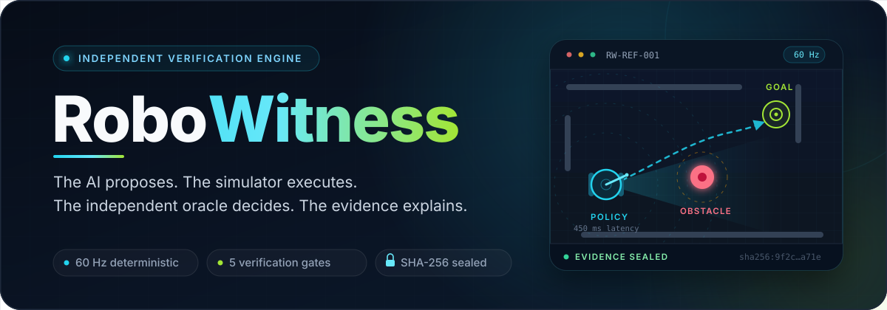
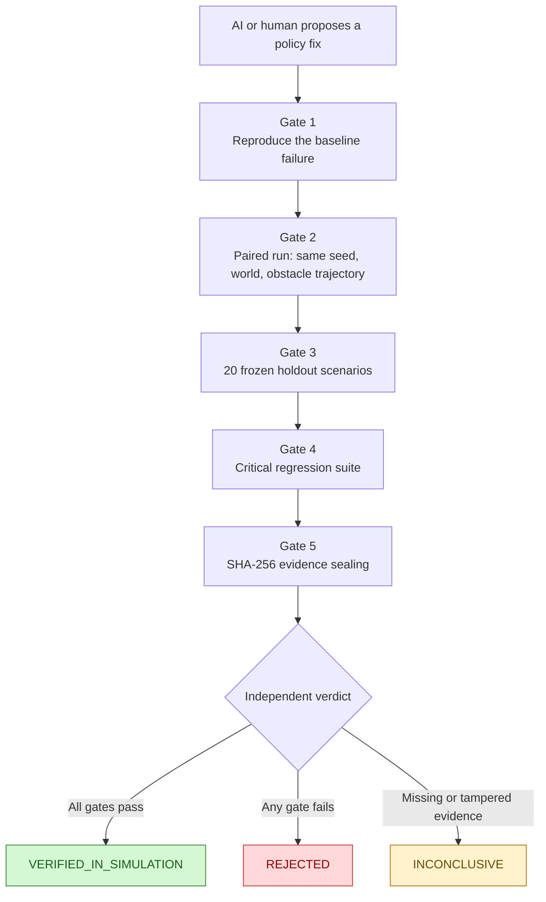

https://github.com/user-attachments/assets/c79c6d78-3461-40df-992b-6364f0d0aee1


https://github.com/user-attachments/assets/47551613-189a-487e-986c-ae2f856d1104

<div align="center">



[](https://www.python.org/)
[](https://fastapi.tiangolo.com/)
[](https://nextjs.org/)
[](https://pybullet.org/)
[](#measured-results)
[](#honest-limitations)
[](LICENSE)

[Demo Video](#demo-video) · [Quick start](#quick-start) · [How it works](#how-it-works) · [The five gates](#the-five-gates) · [Measured results](#measured-results) · [API](#api-surface) · [Documentation](#documentation)

</div>

---

**RoboWitness is a locally runnable, software-only verification engine for AI-generated robotics policy fixes.** It does not ask the AI to grade its own homework. A candidate policy is executed in a deterministic PyBullet world, judged by an independent oracle against true geometry, pushed through five verification gates, and sealed into SHA-256 evidence that anyone can re-check.

> **Core invariant:** the policy only ever sees delayed, noisy sensor observations — never ground truth. The simulator executes. The oracle decides. The evidence explains.

<details>
<summary><strong>Türkçe özet</strong></summary>

<br />

RoboWitness, yapay zekânın önerdiği robot politikası düzeltmelerini bağımsız olarak doğrulayan, tamamen yerelde çalışan bir yazılım doğrulama motorudur. Politika yalnızca gecikmeli ve gürültülü sensör verisi görür; PyBullet simülasyonu deterministik 60 Hz'de çalıştırır; bağımsız oracle gerçek geometriye göre `PASS` / `FAIL` / `INCONCLUSIVE` karar verir; beş kapı ve SHA-256 mühürlü kanıt paketi sonucu değiştirilemez hale getirir. Path B 2026-11-02'de kapandı: ön kayıtlı **MPC-lite** adayı taze v6 setinde **20/20** ile `VERIFIED_IN_SIMULATION` aldı. Varsayılan yasa `shared` olarak kaldı; MPC açıkça etkinleştirilen (`RW_CANDIDATE_LAW=mpc`) doğrulanmış aday konfigürasyonudur. Bu depo, doğrulanmamış bir sonucu asla `VERIFIED` gibi göstermez.

</details>

## Demo Video

<div align="center">

<video src="docs/assets/robowitness-intro.mp4" controls width="100%"></video>

🎬 **RoboWitness Tanıtım ve Doğrulama Videosu (90 sn):** [docs/assets/robowitness-intro.mp4](docs/assets/robowitness-intro.mp4)

</div>

## For hackathon judges (60 seconds)

RoboWitness exists because "the AI fixed my robot" is usually self-graded
homework. Here the fix must pass an exam it cannot see:

1. **It fails first, on camera:** the baseline policy collides at tick 358
   with 0.0016 m clearance — deterministically, every run.
2. **It was rejected, honestly, five times:** across five frozen holdout
   sets, good-looking fixes scored 17/20, 17/20, 18/20, 18/20, 18/20 and were
   REJECTED with sealed evidence. We never lowered the bar.
3. **Then it earned it:** a pre-registered MPC candidate (registered before
   its exam set existed) went **20/20** on the fresh v6 set —
   `verif-6b2bfd8e0501`, **VERIFIED_IN_SIMULATION**, seal independently
   re-verified. An over-cautious control was still rejected in the same run.

Run the whole story offline in ~5 seconds:

```powershell
python scripts\run_hackathon_demo.py
```

Full submission text, demo script and judge notes:
[`docs/HACKATHON_SUBMISSION.md`](docs/HACKATHON_SUBMISSION.md).

## At a glance

| Aspect | Detail |
|---|---|
| **What it is** | A deterministic simulation + independent oracle + 5-gate verification protocol + sealed evidence pipeline for robot policy fixes. |
| **What it is not** | A real-robot test bench, a certified safety authority, or a security sandbox. It verifies simulated behaviour — nothing more, nothing less. |
| **The loop** | Run baseline → inspect measured failure → propose a fix → paired re-run → gates 1–5 → `VERIFIED_IN_SIMULATION`, `REJECTED`, or `INCONCLUSIVE` |
| **Physics** | PyBullet `DIRECT`, fixed 60 Hz tick loop, seeded and repeatable |
| **Interface** | FastAPI backend, atomic SQLite job worker, Next.js 14 dashboard (Turkish UI, English code/docs) |
| **AI modes** | Offline reference mode by default; optional live Meta adapter when credentials are configured |
| **Evidence** | Every run writes telemetry, metrics, events, manifest, and SHA-256 hashes; packages are independently verifiable |
| **License** | BSD 2-Clause |

## Why RoboWitness

Three failure modes make most "AI fixed the robot" claims untrustworthy:

1. **Self-grading.** The model that proposes a fix should not also declare it safe.
2. **Simulation theater.** A pretty replay is not evidence. Without paired runs, frozen holdouts, and objective metrics, a demo proves only that a demo ran.
3. **Unverifiable claims.** "It works" means little without reproducible commands, sealed telemetry, and hashes that survive a second look.

RoboWitness separates the four roles that are usually blurred together:

| Role | Responsibility | Never does |
|---|---|---|
| **Proposer** | Suggests policy changes from measured failure data | Touch the simulator or the oracle |
| **Simulator** | Executes the policy at a fixed 60 Hz timestep | Know the verdict in advance |
| **Oracle** | Applies collision, clearance, goal, timeout, and stuck rules to true state | Read the AI's rationale or trust its confidence |
| **Evidence** | Hashes every artifact with SHA-256 and re-verifies it independently | Assume the producer was honest |

## How it works



A single run looks like this:

```text
Scenario + policy
      │
      ▼
PyBullet DIRECT (60 Hz) ──► true state (x, y, yaw, clearance, contacts)
      │                              │
      │ delayed + noisy observations │
      ▼                              ▼
Controller policy            Independent oracle
      │                              │
      └──────── telemetry ───────────┘
                     │
                     ▼
        PASS / FAIL / INCONCLUSIVE
                     │
                     ▼
      Evidence package + SHA-256 seal
```

The oracle uses objective reason codes: `COLLISION`, `MIN_CLEARANCE_VIOLATION`, `GOAL_NOT_REACHED`, `TIMEOUT`, `STUCK`, and `INCOMPLETE_EVALUATION`. There is no "looks good to me" path.

## The five gates

| Gate | Question it answers | Pass condition |
|---|---|---|
| **1 — Baseline reproduction** | Is the original failure real and repeatable? | The frozen baseline still fails identically from the immutable scenario. |
| **2 — Paired comparison** | Did the fix actually change the measured outcome? | Candidate and baseline run on the same seed, world state, and obstacle trajectory; only the policy hash differs. |
| **3 — Frozen holdout** | Does the fix generalize beyond the tuning set? | All 20 holdout scenarios — never seen during tuning — pass. |
| **4 — Regression suite** | Did the fix break what already worked? | Clear-corridor, stationary-obstacle, and goal-reachability cases still pass. |
| **5 — Evidence sealing** | Can the result be trusted after the fact? | Every artifact is hashed, packaged, and re-verified independently; tampering yields `INCONCLUSIVE`. |

A real measured verdict from this repository — the first pre-registered candidate to pass every gate:

```text
verif-6b2bfd8e0501
  GATE 1  baseline reproduction ......... PASS
  GATE 2  paired comparison ............. PASS
  GATE 3  frozen holdout (20) ........... PASS  20/20
  GATE 4  regression suite .............. PASS
  GATE 5  evidence sealing .............. PASS
  VERDICT ............................... VERIFIED_IN_SIMULATION
```

The same pipeline still rejects bad candidates: the over-cautious control finished `REJECTED` (`verif-3b370a934cfc`). Earlier holdout attempts were rejected honestly too — v2 and v3 at 17/20, v4 at 18/20, v5 at 18/20.

> **No manufactured verdicts.** If one gate fails, the candidate is rejected. `VERIFIED_IN_SIMULATION` is never hard-coded, never inferred from a nice replay, and never awarded because a demo looked convincing.

## Feature tour

### Verification core

- **Deterministic 60 Hz simulation** — PyBullet `DIRECT`, fixed timestep, seeded worlds, bit-identical repeats.
- **Observation honesty** — controllers receive delayed (`0–1000 ms`) and noisy sensor observations, never ground-truth poses.
- **Independent oracle** — collision, minimum-clearance, goal, timeout, and stuck checks against true geometry, with machine-readable reasons.
- **Five-gate protocol** — baseline reproduction, paired comparison, frozen holdout, regressions, and cryptographic sealing.
- **Pluggable candidate law** — the default `shared` law preserves every earlier measurement; the verified **MPC-lite** law (`RW_CANDIDATE_LAW=mpc`) plans over delivered tracks and closed Path B on a fresh pre-registered holdout.
- **Atomic job system** — SQLite WAL queue with single-owner claims, worker heartbeats, cancellation, and honest failure states.
- **Paired replay** — baseline and candidate frames side by side under identical conditions.
- **Sealed evidence** — `manifest.json`, `telemetry.jsonl`, `metrics.json`, `events.jsonl`, `hashes.json`, and an independent verifier.

### Dashboard

The web app is a five-tab Turkish-language workflow designed for non-experts:

| Tab | What it does |
|---|---|
| **Test** | Pick a scenario and robot, run the baseline, watch the 2D replay (canonical) or 3D view (display-only). |
| **İncele** | Read a grounded failure analysis tied to the measured tick and real clearance numbers; near-misses are explained separately from collisions. |
| **Düzeltme** | Adjust the five policy parameters, apply an AI suggestion, or load a saved policy profile. |
| **Sonuç** | Inspect gates 1–5, compare baseline vs candidate replay, and download the sealed evidence ZIP. |
| **Karne** | Run the full exam battery (16 scenarios), get a per-scenario report card, replay any run, and download a Markdown report. |

### Robot and scenario lab

- **Robot catalog** — six built-in profiles (ROBOTIS TurtleBot3 Waffle Pi/Burger, Clearpath Jackal, MiR250, Boston Dynamics Spot, Unitree Go2) plus user-created robots with full specs.
- **Honest compatibility gate** — only differential-drive robots with a body radius of `0.15–0.40 m` can enter this simulator. Others stay in the catalog and are explicitly marked incompatible.
- **Scenario library** — the canonical `RW-REF-001` reference, 20 selectable scenarios (10 `RW-LIB-*`, 5 `RW-ULTRA-*`, 5 `RW-CROWD-*`), 3 regression cases, and a frozen 20-scenario holdout manifest.
- **Policy profiles** — four built-in presets plus your own saved parameter sets, usable in single runs and batteries.
- **Exam battery** — one click runs the reference plus all 20 selectable scenarios (21 total) for a chosen robot and policy profile, then produces a report card.
- **Real-log import** — upload a real drive as CSV (`t_s,x_m,y_m,yaw_rad,min_obstacle_distance_m`) or JSON frames; it is judged by the same rules and labeled `REAL_LOG`.
- **Passive ROS 2 recorder** — `scripts/ros2_bridge.py` listens to `/odom` and `/scan` only and never publishes; without `rclpy` it exits with an honest `[BLOCKED]` message.
- **Local policy plugins (opt-in)** — your own single-file Python policy can drive runs and batteries in a subprocess with timeouts and output clamping. This is **not** a security sandbox, and AI-generated code is forbidden there.

### Enterprise layer (opt-in)

Documented in `docs/ENTERPRISE.md`; with nothing configured, everything keeps working in open local mode:

- **Auth, roles, workspaces** — `RW_API_KEYS=key:role:workspace;…` enables API-key auth (`admin` > `editor` > `viewer`) and logical workspace isolation for tenant data (robots, profiles, batteries, imports).
- **Audit and metrics** — every write is recorded in an audit trail; `GET /api/audit` (admin) and `GET /api/metrics` expose workspace counts and job states.
- **Battery comparison** — diff two report cards scenario by scenario (İYİLEŞTİ/KÖTÜLEŞTİ), in the Karne tab or via `GET /api/batteries/compare`.
- **Map import** — draw your own environment as an occupancy grid (`#` obstacle, `S` start, `G` goal) and convert it to a validated scenario (`POST /api/maps/scenario`).
- **CI gate** — `scripts/ci_battery_gate.py` runs a battery through the API and fails the pipeline (exit 1) when pass-rate/collision thresholds are missed.

## Quick start

### Prerequisites

| Requirement | Version / note |
|---|---|
| Python | 3.11+ |
| Node.js | 18.17+ (Next.js 14) |
| Git | Any recent version |
| C++ build tools | Windows only: MSVC 2019+ Build Tools for PyBullet (PyPI has no `cp311` Windows wheel for `pybullet==3.2.5`) |
| GPU | Not required |

### 1. Bootstrap

**Windows (PowerShell):**

```powershell
.\scripts\bootstrap.ps1
```

**macOS / Linux:**

```bash
./scripts/bootstrap.sh
```

**Manual install:**

```bash
cd backend
python -m venv .venv
# Windows: .\.venv\Scripts\Activate.ps1
source .venv/bin/activate
pip install -e ".[dev]"

cd ../apps/web
npm install
```

### 2. Start the three services

**Terminal A — FastAPI backend**

```powershell
cd backend
.\.venv\Scripts\uvicorn.exe app.main:app --host 127.0.0.1 --port 8000 --reload
```

**Terminal B — background job worker**

```powershell
cd backend
.\.venv\Scripts\python.exe -m app.jobs.worker
```

**Terminal C — Next.js dashboard**

```powershell
cd apps/web
npm run dev
```

Open **[http://localhost:3000](http://localhost:3000)**.

> On macOS/Linux, replace `.\.venv\Scripts\...` with `.venv/bin/...`.

### 3. See it work without the UI

The offline demo runs real simulations end to end — no mocks, no pre-written verdicts:

```bash
python scripts/run_offline_demo.py
```

It loads `RW-REF-001`, runs the baseline, runs an improved candidate, runs an over-cautious candidate, and prints the measured oracle verdicts. No Meta API key is required. Sealed evidence packages are produced by the API worker (`POST /api/runs` → `POST /api/fixes/verify`).

Expected shape of the output:

```text
[BASELINE]     oracle=FAIL  reasons=[...]  ticks=...  min_clear=0.0016  goal=False  collision=True
[CANDIDATE]    oracle=...   reasons=[...]  ...
[OVERCAUTIOUS] oracle=...   reasons=[...]  ...
Done. Baseline=FAIL Candidate=... OverCautious=...
```

### Windows note: PyBullet from source

PyPI ships no `cp311` Windows wheel for `pybullet==3.2.5`, so Windows installs compile it with MSVC 2019+ (Build Tools are sufficient):

```powershell
& "C:\Program Files (x86)\Microsoft Visual Studio\2019\BuildTools\VC\Auxiliary\Build\vcvarsall.bat" x64
$env:DISTUTILS_USE_SDK=1; $env:MSSdk=1
python -m pip install wheel setuptools
python -m pip install --no-build-isolation pybullet==3.2.5
```

## Measured results

All numbers below were measured in this repository. The full log, commands, IDs, and artifacts live in [`docs/IMPLEMENTATION_STATUS.md`](docs/IMPLEMENTATION_STATUS.md).

| Check | Measured result (2026-11-02) |
|---|---|
| Backend test suite | **138 passed** (unit + integration) |
| Backend quality | `ruff format --check` + `ruff check --select E,F` clean |
| Frontend quality | `npm run lint`, `npm run typecheck`, `npm run build` clean |
| Path A — failure detected | Baseline `RW-REF-001` deterministically `FAIL`s: `COLLISION` at tick 358, min clearance `0.0016 m`, identical across 3/3 repeats |
| Path B — improvement accepted | **CLOSED.** `verif-6b2bfd8e0501` → `VERIFIED_IN_SIMULATION`; all five gates PASS, Gate 3 **20/20** on the pre-registered v6 holdout using MPC-lite (`RW_CANDIDATE_LAW=mpc`) |
| Path C — rejection demonstrated | Over-cautious candidate `REJECTED` on paired, holdout, and regression gates (`verif-3b370a934cfc`) |
| Evidence integrity | Sealed packages re-verify with `scripts/verify_evidence.py`; tamper or missing member → `INCONCLUSIVE` |
| Exam battery example | TurtleBot3 Waffle Pi + baseline: **4/11 PASS**, 5 collisions, 2 near-misses, worst clearance `0.003 m` |

**Holdout history — no tuning on the eval set:**

| Frozen set | Role | Result |
|---|---|---|
| v1 | Development (used for tuning, then archived) | 20/20 |
| v2 | Evaluation | 17/20 → `REJECTED` |
| v3 | Evaluation | 17/20 → `REJECTED` |
| v4 | Evaluation | 18/20 → `REJECTED` |
| v5 | Evaluation, pre-registered | 18/20 → `REJECTED` (`verif-ec5ae352765d`) |
| v6 | Evaluation, pre-registered, fresh recipe seed | **20/20 → `VERIFIED_IN_SIMULATION`** (`verif-6b2bfd8e0501`, MPC-lite) |

> **Honest by design:** the v6 set was generated only after the candidate law was frozen, with a recipe seed never used before, and the MPC attempt was single-shot. A worker race also produced an extra shared-law data point on v6 (`verif-1db21e6713ad`, 18/20 `REJECTED`); it is recorded in the pre-registration doc instead of being hidden. Default behavior remains the `shared` law, so every earlier measurement is unchanged; MPC is the verified candidate configuration, enabled explicitly.

## API surface

Interactive OpenAPI docs are available at **`http://127.0.0.1:8000/docs`** while the backend runs.

| Method | Endpoint | Purpose |
|---|---|---|
| `GET` | `/api/health` | Service health and truthful worker heartbeat |
| `GET` | `/api/scenarios/reference` | Canonical `RW-REF-001` scenario |
| `GET` | `/api/scenarios/library` | The 20 selectable library scenarios (10 normal + 5 ultra + 5 crowd) |
| `POST` | `/api/scenarios/generate` | Generate a scenario (offline reference or live AI) |
| `POST` | `/api/runs` | Queue a simulation run |
| `GET` | `/api/runs/{run_id}` | Run result, metrics, and oracle verdict |
| `GET` | `/api/jobs/{job_id}` | Job progress |
| `POST` | `/api/jobs/{job_id}/cancel` | Cancel a queued or running job |
| `POST` | `/api/failures/{run_id}/investigate` | Grounded failure analysis; returns `409` for non-FAIL runs |
| `POST` | `/api/fixes/verify` | Queue the five-gate verification |
| `GET` | `/api/verifications` | Verification history |
| `GET` | `/api/verifications/{id}` | Gate results and comparison |
| `GET` | `/api/verifications/{id}/candidate-telemetry` | Sealed candidate replay frames |
| `GET` | `/api/evidence/{id}` | Evidence manifest |
| `GET` | `/api/evidence/{id}/download` | Safe ZIP download |
| `GET` / `POST` | `/api/robots` | List / create robot profiles |
| `GET` / `POST` | `/api/policy-profiles` | List / create policy presets |
| `POST` | `/api/batteries` | Queue the full exam battery (21 scenarios) |
| `GET` | `/api/batteries/{id}/report.md` | Download the Markdown report card |
| `POST` | `/api/imports/telemetry` | Import a real drive log (CSV or JSON) |
| `GET` | `/api/local-policies` | List opt-in local policy plugins |
| `GET` | `/api/metrics`, `/api/audit` | Operational metrics and audit trail |

Optional API-key auth (`X-API-Key`) supports `admin`, `editor`, and `viewer` roles. With no keys configured, the app runs in open local mode.

## Project layout

```text
robowitness/
├── backend/
│   ├── app/
│   │   ├── api/              # REST endpoints under /api
│   │   ├── simulation/       # PyBullet DIRECT, 60 Hz, sensor pipeline
│   │   ├── policies/         # Baseline, configurable, profiles, local plugins
│   │   ├── verification/     # Oracle, paired, holdout, regression, sealing
│   │   ├── evidence/         # SHA-256 recorder, reports, ZIP packaging
│   │   ├── ai/               # Offline reference + optional Meta adapter
│   │   ├── jobs/             # Atomic SQLite worker
│   │   ├── robots/           # Robot catalog and repository
│   │   ├── ros_bridge/       # Pure ROS log format converters
│   │   └── schemas/          # Pydantic v2 domain models
│   └── tests/                # Unit, integration, and end-to-end tests
├── apps/web/                 # Next.js 14 + React 18 + Three.js dashboard
├── scenarios/
│   ├── reference/            # RW-REF-001
│   ├── regression/           # 3 critical regression cases
│   ├── library/              # 10 selectable scenarios + catalog.json
│   ├── ultra/                # 5 ultra-hard showcase scenarios + catalog.json
│   ├── crowd/                # 5 crowd-traffic scenarios + catalog.json
│   └── holdout/              # Frozen 20-scenario manifests (v1–v6, archived eval sets)
├── scripts/                  # Bootstrap, demo, evidence verifier, ROS bridge
├── docs/                     # Contracts, evidence format, demo guide, status
├── artifacts/                # Runs, verifications, SQLite DB, evidence output
├── ROBOWITNESS_AGENT_EXECUTION_BLUEPRINT.md
└── README.md
```

## Testing and quality

```bash
# Backend test suite
cd backend
pytest -v

# Backend lint and formatting
ruff format --check app tests
ruff check --select E,F .

# Frontend checks
cd ../apps/web
npm run lint
npm run typecheck
npm run build

# Fast import/schema smoke test
cd ../..
python scripts/smoke_test.py

# Independently verify any sealed evidence package
python scripts/verify_evidence.py artifacts/verifications/<verification_id>

# Reproduce the pre-registered Path B evaluation with the verified MPC-lite law
# Windows PowerShell:
$env:RW_CANDIDATE_LAW = "mpc"
# macOS / Linux: export RW_CANDIDATE_LAW=mpc
python scripts/run_final_evaluation.py
```

The verifier recomputes every SHA-256 digest. A missing file or a mismatched hash produces `ARTIFACT_INTEGRITY_FAILURE` and an `INCONCLUSIVE` verdict — the pipeline would rather say "I don't know" than "trust me."

## Documentation

| Document | Contents |
|---|---|
| [`ROBOWITNESS_AGENT_EXECUTION_BLUEPRINT.md`](ROBOWITNESS_AGENT_EXECUTION_BLUEPRINT.md) | Full architecture, invariants, and phase requirements |
| [`docs/IMPLEMENTATION_STATUS.md`](docs/IMPLEMENTATION_STATUS.md) | Live phase status, measured commands, artifacts, and open gaps |
| [`docs/PATH_B_V6_PREREGISTRATION.md`](docs/PATH_B_V6_PREREGISTRATION.md) | Frozen candidate law, fresh v6 recipe, and the measured `VERIFIED` result |
| [`docs/PATH_B_V5_PREREGISTRATION.md`](docs/PATH_B_V5_PREREGISTRATION.md) | Previous pre-registered attempt and its 18/20 `REJECTED` result |
| [`docs/ENTERPRISE.md`](docs/ENTERPRISE.md) | Auth, workspaces, audit, schedules, backup/restore, and deployment |
| [`docs/CONTRACTS.md`](docs/CONTRACTS.md) | Canonical schemas and API contracts |
| [`docs/EVIDENCE_FORMAT.md`](docs/EVIDENCE_FORMAT.md) | Evidence package structure and sealing rules |
| [`docs/DEMO_GUIDE.md`](docs/DEMO_GUIDE.md) | Path A/B/C demonstration scripts |
| [`AGENTS.md`](AGENTS.md) | Instructions for autonomous coding agents |

## Honest limitations

- **Software-only, planar world.** The simulator models a 2D warehouse with circular obstacles. It is not a real-robot test bench, a certified safety authority, or a substitute for physical validation.
- **Path B is verified in simulation, with an opt-in law.** The winning MPC-lite candidate passed the pre-registered v6 holdout 20/20, but only when `RW_CANDIDATE_LAW=mpc` is enabled; the default remains the shared law. This is simulator evidence within a fixed 2D operational design domain, not a physical-robot guarantee.
- **The 3D view is display-only.** The 2D canvas is the canonical evidence view; Three.js mirrors the same frames for visualization and never touches physics, the oracle, or evidence.
- **Built-in robot specs are nominal examples.** They are catalog values, not manufacturer-certified measurements. Robots the differential-drive simulator cannot represent are marked incompatible instead of being silently approximated.
- **Live ROS 2 is unverified here.** The recorder is passive by design, and this development machine has no ROS installation. Without `rclpy`, it exits with an honest `[BLOCKED]` message.
- **Local policy plugins are not a sandbox.** They are opt-in, subprocess-isolated, timeout-bounded, and output-clamped — but only trusted, user-written code belongs there. AI-generated code is explicitly forbidden.
- **Live Meta connectivity is optional.** Offline reference mode is the default and fully supported; live AI calls require your own base URL, model, and key.
- **Evidence proves integrity, not physical truth.** SHA-256 sealing proves the recorded artifacts were not altered after the fact. It does not prove the simulator matches reality.

## Contributing

Issues and pull requests are welcome. Before opening a PR:

1. Run the backend tests and frontend checks above.
2. Keep the invariant intact: never let a policy see ground truth, never let the proposer grade itself, and never manufacture a verdict.
3. Add measured evidence for behavioural claims — commands, IDs, and artifacts, not adjectives.

## License

BSD 2-Clause License. See [`LICENSE`](LICENSE).

Copyright (c) 2026, Ahmet Aras Akyasan.

---

<div align="center">

**If a result cannot survive an independent re-check, it is not a result.**

Built with Python, FastAPI, PyBullet, Next.js, and an unreasonable commitment to honest verdicts.

</div>
