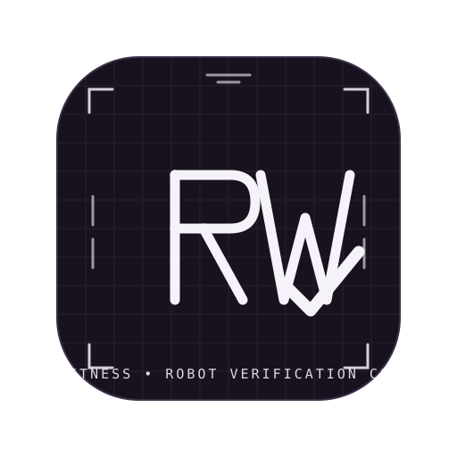

<p align="center">
  
</p>

# RoboWitness

**Independent verification engine for AI-generated robotics policies.**

> **The problem:** an AI writes a fix for your robot — and everyone trusts that
> same AI's confidence. No independent test, no proof.
>
> **What RoboWitness does:** every AI-generated policy fix must pass an exam it
> cannot see and cannot grade. The AI proposes the fix → a deterministic
> simulator executes it → an independent oracle judges true geometry →
> five verification gates and SHA-256-sealed evidence produce the verdict:
> `VERIFIED_IN_SIMULATION`, `REJECTED`, or an honest "we don't know."

*The AI proposes. The simulator executes. The oracle decides. The evidence proves it.*

[](https://youtu.be/6f0TXazTw_w)

[](https://github.com/Pentexa/robowitness/actions/workflows/ci.yml)
[](https://www.python.org/)
[](https://fastapi.tiangolo.com/)
[](https://nextjs.org/)
[](https://pybullet.org/)
[](#-measured-results)
[](LICENSE)

<details>
<summary><strong>Türkçe Özet</strong></summary>

RoboWitness, yapay zekânın önerdiği robot politikası düzeltmelerini bağımsız
olarak doğrulayan, tamamen yerelde çalışan bir doğrulama motorudur. Politika
yalnızca gecikmeli ve gürültülü sensör verisi görür; PyBullet simülasyonu
deterministik 60 Hz'de çalışır; bağımsız oracle gerçek geometriye göre
`PASS` / `FAIL` / `INCONCLUSIVE` karar verir; beş kapı ve SHA-256 mühürlü
kanıt paketi sonucu değiştirilemez hale getirir.

</details>

---

## How It Works

```
Scenario + policy
      │
      ▼
PyBullet DIRECT (60 Hz) ──► true state (x, y, yaw, clearance, contacts)
      │                              │
      │ delayed + noisy observations │
      ▼                              ▼
Controller policy            Independent oracle
      │                              │
      └──────── telemetry ───────────┘
                     ▼
        PASS / FAIL / INCONCLUSIVE
                     ▼
      Evidence package + SHA-256 seal
```

Four roles stay strictly separated:

| Role | Responsibility | Never Does |
|:---:|---|---|
| 🧠 **Proposer (AI)** | Suggests policy changes from measured failure data | Touch the simulator or the oracle |
| ⚙️ **Simulator** | Executes the proposed policy at a fixed 60 Hz timestep | Know the verdict in advance |
| ⚖️ **Oracle** | Applies collision, clearance, goal, timeout, stuck rules to true state | Read the AI's rationale or trust its confidence |
| 📦 **Evidence** | Hashes every artifact with SHA-256 and re-verifies independently | Assume the producer was honest |

### The Five Gates

| Gate | Question It Answers | Pass Condition |
|:---:|---|---|
| **1 — Baseline Reproduction** | Is the original failure real and repeatable? | The frozen baseline still fails identically from the immutable scenario |
| **2 — Paired Comparison** | Did the fix actually change the measured outcome? | Candidate and baseline run on the same seed, world, and obstacle trajectory |
| **3 — Frozen Holdout** | Does the fix generalize beyond the tuning set? | All 20 holdout scenarios — never seen during tuning — pass |
| **4 — Regression Suite** | Did the fix break what already worked? | Clear-corridor, stationary-obstacle, and goal-reachability cases still pass |
| **5 — Evidence Sealing** | Can the result be trusted after the fact? | Every artifact is hashed, packaged, and re-verified independently |

A failed gate means `REJECTED`. Missing or tampered evidence means
`INCONCLUSIVE`. `VERIFIED_IN_SIMULATION` is never hard-coded and never inferred
from a nice replay. See [`docs/VERIFICATION.md`](docs/VERIFICATION.md).

## Features

- **Deterministic 60 Hz simulation** — PyBullet `DIRECT`, seeded, bit-identical repeats
- **Observation honesty** — controllers see delayed (0–1000 ms), noisy sensors, never ground truth
- **Independent oracle** — objective reason codes: `COLLISION`, `MIN_CLEARANCE_VIOLATION`, `GOAL_NOT_REACHED`, `TIMEOUT`, `STUCK`
- **Five-gate verification** with sealed, independently re-checkable evidence
- **Pluggable candidate laws** — default `shared` law; verified **MPC-lite** law is opt-in (`RW_CANDIDATE_LAW=mpc`)
- **Atomic job system** — SQLite WAL queue with worker heartbeats and honest failure states
- **AI integration** — scenario generation, grounded failure investigation, and 5-parameter fix proposals (live Meta models or an offline reference fallback); photo-to-scenario via SAM 3.1
- **Product surface** — robot catalog, 20-scenario library, exam batteries with report cards, policy profiles, real-drive log judging, map/photo import, passive ROS 2 recorder
- **Extras** — sensor stress-test heatmap, adversarial testing, failure timeline, evidence-ZIP inspector, portable HTML reports

### Dashboard (Next.js)

| Tab | What It Does |
|:---:|---|
| 🧪 **Test** | Pick a scenario and robot, run the baseline, watch the 2D replay (or a display-only 3D view) |
| 🔍 **Inspect** | Read a grounded failure analysis tied to the measured tick and clearance |
| 🔧 **Fix** | Adjust the five policy parameters or apply an AI suggestion |
| 📊 **Result** | Inspect gates 1–5, compare replays, download sealed evidence ZIP |
| 📝 **Report Card** | Run the 11-scenario exam battery and download a report |
| 🛠️ **Admin** | API keys, scheduled batteries, backups, metrics, audit trail |

## Quick Start

Requirements: Python 3.11+, Node.js 18.17+, Git. No GPU needed. On Windows,
PyBullet compiles with MSVC 2019+ Build Tools (the bootstrap script handles it).

```bash
# 1. Install
./scripts/bootstrap.sh        # Windows: .\scripts\bootstrap.ps1

# 2. Start three services
cd backend  && uvicorn app.main:app --port 8000 --reload
cd backend  && python -m app.jobs.worker
cd apps/web && npm run dev
```

Open **http://localhost:3000**.

Without the UI, run the whole story offline in seconds:

```bash
python scripts/run_offline_demo.py
```

No API key is required — the offline reference mode works out of the box.
For live AI, set `RW_AI_MODE=live` plus `RW_META_BASE_URL`, `RW_META_MODEL`,
and `RW_META_API_KEY` in `.env`.

## Measured Results

Recorded from the project's own tests and simulation runs. Reproduction
commands and recorded outcomes live in [`docs/VERIFICATION.md`](docs/VERIFICATION.md).

| Check | Result |
|---|---|
| Backend test suite | 213 passed (unit + integration) |
| Frontend E2E (Playwright, live stack) | 24 passed |
| Baseline failure | `RW-REF-001` fails deterministically: collision at tick 358, min clearance 0.0016 m, identical across repeats |
| Verified fix | `verif-6b2bfd8e0501` → `VERIFIED_IN_SIMULATION` — all five gates pass, 20/20 holdout |
| Honest rejection | Over-cautious candidate `REJECTED` (`verif-3b370a934cfc`) |
| Evidence integrity | Sealed packages re-verify with `scripts/verify_evidence.py`; tampering → `INCONCLUSIVE` |

### Holdout History — No Tuning on the Eval Set

| Frozen Set | Role | Result |
|:---:|---|---|
| v1 | Development (archived) | 20/20 |
| v2–v5 | Evaluation, frozen | 17/20, 17/20, 18/20, 18/20 — all `REJECTED` |
| **v6** | Evaluation, pre-registered | **20/20 → `VERIFIED_IN_SIMULATION`** (MPC-lite) |

## Project Layout

```
robowitness/
├── backend/          # FastAPI app, PyBullet simulation, oracle, evidence, jobs, tests
├── apps/web/         # Next.js 14 + React 18 + Three.js dashboard
├── scenarios/        # Reference, library, ultra, crowd, and frozen holdout sets
├── scripts/          # Bootstrap, demos, evidence verifier, ROS bridge, CI gate
├── docs/             # Documentation
└── artifacts/        # Runs, verifications, SQLite DB, evidence output
```

## Testing

```bash
cd backend && pytest -v             # backend suite
cd apps/web && npm run lint && npm run typecheck && npm run build
python scripts/smoke_test.py        # fast import/schema smoke test

# Re-verify any sealed evidence package
python scripts/verify_evidence.py artifacts/verifications/<verification_id>

# Reproduce the recorded Path-B evaluation (MPC)
RW_CANDIDATE_LAW=mpc python scripts/run_final_evaluation.py
```

## Documentation

| Document | Contents |
|---|---|
| [`docs/USAGE.md`](docs/USAGE.md) | How to run and use the product, end to end |
| [`docs/VERIFICATION.md`](docs/VERIFICATION.md) | Five-gate protocol, recorded outcomes, reproduction |
| [`docs/API.md`](docs/API.md) | Canonical schemas and REST endpoint reference |
| [`docs/EVIDENCE.md`](docs/EVIDENCE.md) | Evidence package structure and sealing rules |
| [`docs/ENTERPRISE.md`](docs/ENTERPRISE.md) | Optional auth, workspaces, audit, backups, deployment |
| [`docs/DEVELOPMENT.md`](docs/DEVELOPMENT.md) | CI/CD, releases, and contributing |
| [`docs/CHANGELOG.md`](docs/CHANGELOG.md) | Release history |

## Honest Limitations

- **Software-only, planar world.** A 2D warehouse with circular obstacles — not a real-robot
  test bench or a certified safety authority.
- **The 3D view is display-only.** The 2D canvas is the canonical evidence view; Three.js
  never touches physics, the oracle, or evidence.
- **Live AI needs your key.** With no key, the offline reference mode runs the full pipeline
  and every claim stays reproducible offline.
- **Evidence proves integrity, not physical truth.** SHA-256 sealing proves recorded
  artifacts were not altered — not that the simulator matches reality.
- **Local policy plugins are not a sandbox.** Opt-in, subprocess-isolated, timeout-bounded.

## License

MIT. See [`LICENSE`](LICENSE). Copyright © 2026, **Ahmet Aras Akyasan**.
