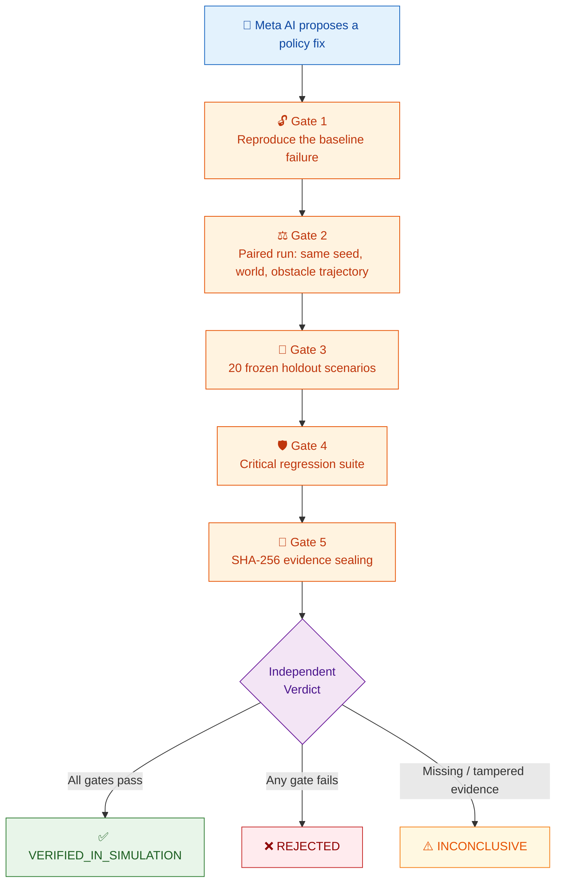
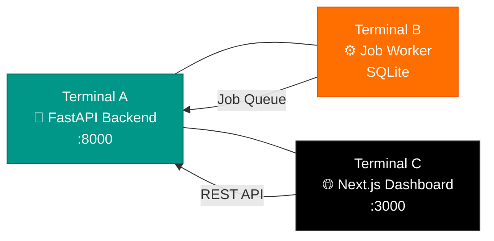

<br />

# 🤖 RoboWitness

### Independent Verification Engine for AI-Generated Robotics Policies
### ⚡ Powered by Meta AI

*Meta AI proposes. The simulator executes. The oracle decides. The evidence proves it.*

<br />

[](https://www.python.org/)
[](https://fastapi.tiangolo.com/)
[](https://docs.pydantic.dev/)
[](https://nextjs.org/)
[](https://react.dev/)
[](https://threejs.org/)
[](https://pybullet.org/)
[](https://www.typescriptlang.org/)
[](#-powered-by-meta-ai)

<br />

[](#-measured-results)
[](#-honest-limitations)
[](#how-it-works)
[](#-evidence-sealing)
[](LICENSE)
[](#-contributing)

<br />

[🚀 Quick Start](#-quick-start) · [⚙️ How It Works](#how-it-works) · [🔐 Five Gates](#-the-five-gates) · [📊 Results](#-measured-results) · [🌐 API](#-api-surface) · [📖 Docs](#-documentation)

<br />

---

<br />

> **💡 "If a result cannot survive an independent re-check, it is not a result."**

</div>

<br />

## 🎯 What is RoboWitness?

**RoboWitness** is a locally runnable, software-only verification engine for **Meta AI-generated** robotics policy fixes. Powered by **Meta AI**, it never asks Meta AI to grade its own homework.

**Meta AI** proposes a candidate policy fix → it is executed in a deterministic PyBullet world → judged by an independent oracle against true geometry → pushed through five verification gates → sealed into SHA-256 evidence that anyone can re-check.

> [!IMPORTANT]
> **Core Invariant:** The policy only ever sees delayed, noisy sensor observations — never ground truth.
> **Meta AI proposes. The simulator executes. The oracle decides. The evidence explains.**

<details>
<summary><strong>🇹🇷 Türkçe Özet</strong></summary>

<br />

RoboWitness, yapay zekânın önerdiği robot politikası düzeltmelerini bağımsız olarak doğrulayan, tamamen yerelde çalışan bir yazılım doğrulama motorudur. Politika yalnızca gecikmeli ve gürültülü sensör verisi görür; PyBullet simülasyonu deterministik 60 Hz'de çalıştırır; bağımsız oracle gerçek geometriye göre `PASS` / `FAIL` / `INCONCLUSIVE` karar verir; beş kapı ve SHA-256 mühürlü kanıt paketi sonucu değiştirilemez hale getirir. Path B 2026-11-02'de kapandı: ön kayıtlı **MPC-lite** adayı taze v6 setinde **20/20** ile `VERIFIED_IN_SIMULATION` aldı.

</details>

<br />

## ⚡ For Hackathon Judges — 60 Seconds

RoboWitness exists because **"the AI fixed my robot"** is usually self-graded homework. Here the fix must pass an exam it cannot see:

| # | What Happened | Evidence |
|:---:|---|---|
| 🔴 | **It fails first, on camera** — the baseline policy collides at tick 358 with `0.0016 m` clearance — deterministically, every run | Reproducible with seed |
| 🟡 | **It was rejected, honestly, five times** — across five frozen holdout sets, good-looking fixes scored 17/20, 17/20, 18/20, 18/20, 18/20 and were `REJECTED` with sealed evidence | We never lowered the bar |
| 🟢 | **Then it earned it** — a pre-registered MPC candidate (registered before its exam set existed) went **20/20** on the fresh v6 set | `verif-6b2bfd8e0501` — `VERIFIED_IN_SIMULATION` |

```powershell
# Run the whole story offline in ~5 seconds:
python scripts\run_hackathon_demo.py
```

> [!TIP]
> Full submission text, demo script & judge notes → [`docs/HACKATHON_SUBMISSION.md`](docs/HACKATHON_SUBMISSION.md)

<br />

## 📋 At a Glance

<table>
<tr>
<td width="200"><strong>🏗️ What it is</strong></td>
<td>A deterministic simulation + independent oracle + 5-gate verification protocol + sealed evidence pipeline for robot policy fixes</td>
</tr>
<tr>
<td><strong>🚫 What it is not</strong></td>
<td>A real-robot test bench, a certified safety authority, or a security sandbox. It verifies simulated behaviour — nothing more, nothing less</td>
</tr>
<tr>
<td><strong>🔄 The loop</strong></td>
<td>Run baseline → inspect measured failure → propose a fix → paired re-run → gates 1–5 → <code>VERIFIED_IN_SIMULATION</code>, <code>REJECTED</code>, or <code>INCONCLUSIVE</code></td>
</tr>
<tr>
<td><strong>⚛️ Physics</strong></td>
<td>PyBullet <code>DIRECT</code>, fixed 60 Hz tick loop, seeded and repeatable</td>
</tr>
<tr>
<td><strong>🖥️ Interface</strong></td>
<td>FastAPI backend, atomic SQLite job worker, Next.js 14 dashboard (Turkish UI, English code/docs)</td>
</tr>
<tr>
<td><strong>🤖 AI modes</strong></td>
<td><strong>Powered by Meta AI</strong> — offline reference mode by default; optional live Meta AI adapter (`RW_META_MODEL`, `RW_META_BASE_URL`, `RW_META_API_KEY`) for real-time scenario generation, failure investigation & fix proposals</td>
</tr>
<tr>
<td><strong>📦 Evidence</strong></td>
<td>Every run writes telemetry, metrics, events, manifest, and SHA-256 hashes; packages are independently verifiable</td>
</tr>
<tr>
<td><strong>⚖️ License</strong></td>
<td>BSD 2-Clause</td>
</tr>
</table>

<br />

## 🤔 Why RoboWitness?

Three failure modes make most "Meta AI fixed the robot" claims untrustworthy:

```
  ┌─────────────────────────────────────────────────────────────────────┐
  │                                                                     │
  │   1️⃣  SELF-GRADING     The model that proposes a fix should not    │
  │                         also declare it safe                        │
  │                                                                     │
  │   2️⃣  SIMULATION       A pretty replay is not evidence. Without    │
  │      THEATER            paired runs, frozen holdouts, and objective │
  │                         metrics, a demo proves only that a demo ran │
  │                                                                     │
  │   3️⃣  UNVERIFIABLE     "It works" means little without             │
  │      CLAIMS             reproducible commands, sealed telemetry,    │
  │                         and hashes that survive a second look       │
  │                                                                     │
  └─────────────────────────────────────────────────────────────────────┘
```

RoboWitness separates the four roles that are usually blurred together — with **Meta AI** as the brilliant proposer:

| Role | Responsibility | Never Does |
|:---:|---|---|
| 🧠 **Proposer — Meta AI** | **Meta AI** suggests policy changes from measured failure data: new scenarios, grounded failure explanations, 5-parameter fix patches | Touch the simulator or the oracle |
| ⚙️ **Simulator** | Executes the **Meta AI-proposed** policy at a fixed 60 Hz timestep | Know the verdict in advance |
| ⚖️ **Oracle** | Applies collision, clearance, goal, timeout, and stuck rules to true state | Read Meta AI's rationale or trust its confidence |
| 📦 **Evidence** | Hashes every artifact with SHA-256 and re-verifies independently | Assume the producer was honest |

<br />

## ⚡ Powered by Meta AI

**Meta AI is the intelligence at the heart of RoboWitness.** Every improvement starts with Meta AI:

- 🗺️ **Scenario generation** — Meta AI creates challenging warehouse scenarios (`POST /api/scenarios/generate`), validated by Pydantic schemas
- 🔍 **Failure investigation** — Meta AI explains *why* the baseline failed in terms of measured ticks, clearances and testable hypotheses (`POST /api/failures/{run_id}/investigate`)
- 🔧 **Fix proposals** — Meta AI proposes a patch with only the five allowed numeric `PolicyConfig` fields — never code, never oracle thresholds
- 🛡️ **Strict separation** — Meta AI never touches physics, never reads ground truth, never declares itself verified. The oracle alone decides
- 🔌 **Flexible modes** — offline reference mode works with zero keys; set `RW_AI_MODE=live` + `RW_META_API_KEY` + `RW_META_MODEL` to unleash live Meta AI

> Meta AI brings the creativity. RoboWitness brings the proof.

<br />

## How It Works



<br />

### 🔬 Single Run Architecture

```
Scenario + policy
      │
      ▼
PyBullet DIRECT (60 Hz) ──► true state (x, y, yaw, clearance, contacts)
      │                              │
      │ delayed + noisy observations │
      ▼                              ▼
Controller policy            Independent oracle
      │                              │
      └──────── telemetry ───────────┘
                     │
                     ▼
        PASS / FAIL / INCONCLUSIVE
                     │
                     ▼
      Evidence package + SHA-256 seal
```

The oracle uses objective reason codes: `COLLISION`, `MIN_CLEARANCE_VIOLATION`, `GOAL_NOT_REACHED`, `TIMEOUT`, `STUCK`, and `INCOMPLETE_EVALUATION`. There is no "looks good to me" path.

<br />

## 🔐 The Five Gates

| Gate | Question It Answers | Pass Condition |
|:---:|---|---|
| **1 — Baseline Reproduction** 🔓 | Is the original failure real and repeatable? | The frozen baseline still fails identically from the immutable scenario |
| **2 — Paired Comparison** ⚖️ | Did the fix actually change the measured outcome? | Candidate and baseline run on the same seed, world state, and obstacle trajectory; only the policy hash differs |
| **3 — Frozen Holdout** 🎯 | Does the fix generalize beyond the tuning set? | All 20 holdout scenarios — never seen during tuning — pass |
| **4 — Regression Suite** 🛡️ | Did the fix break what already worked? | Clear-corridor, stationary-obstacle, and goal-reachability cases still pass |
| **5 — Evidence Sealing** 🔐 | Can the result be trusted after the fact? | Every artifact is hashed, packaged, and re-verified independently; tampering yields `INCONCLUSIVE` |

<br />

### ✅ Real Measured Verdict

The first pre-registered candidate to pass every gate:

```
╔═══════════════════════════════════════════════════════════════╗
║  verif-6b2bfd8e0501                                         ║
║                                                               ║
║  GATE 1  baseline reproduction ......... ✅ PASS             ║
║  GATE 2  paired comparison ............. ✅ PASS             ║
║  GATE 3  frozen holdout (20) ........... ✅ PASS  20/20      ║
║  GATE 4  regression suite .............. ✅ PASS             ║
║  GATE 5  evidence sealing .............. ✅ PASS             ║
║                                                               ║
║  VERDICT ............................... 🏆 VERIFIED          ║
║                                          IN_SIMULATION        ║
╚═══════════════════════════════════════════════════════════════╝
```

The same pipeline still rejects bad candidates: the over-cautious control finished `REJECTED` (`verif-3b370a934cfc`). Earlier holdout attempts were rejected honestly too — v2 and v3 at 17/20, v4 at 18/20, v5 at 18/20.

> [!CAUTION]
> **No manufactured verdicts.** If one gate fails, the candidate is rejected. `VERIFIED_IN_SIMULATION` is never hard-coded, never inferred from a nice replay, and never awarded because a demo looked convincing.

<br />

## 🎨 Feature Tour

### 🔬 Verification Core

| Feature | Description |
|---|---|
| **🤖 Meta AI Intelligence** | **Powered by Meta AI** — scenario generation, grounded failure investigation & 5-parameter fix proposals via `MetaAdapter`; offline reference fallback included |
| **Deterministic 60 Hz Simulation** | PyBullet `DIRECT`, fixed timestep, seeded worlds, bit-identical repeats |
| **Observation Honesty** | Controllers receive delayed (`0–1000 ms`) and noisy sensor observations, never ground-truth poses |
| **Independent Oracle** | Collision, minimum-clearance, goal, timeout, and stuck checks against true geometry with machine-readable reasons |
| **Five-Gate Protocol** | Baseline reproduction, paired comparison, frozen holdout, regressions, and cryptographic sealing |
| **Pluggable Candidate Law** | Default `shared` law preserves every earlier measurement; verified **MPC-lite** law (`RW_CANDIDATE_LAW=mpc`) plans over delivered tracks and closed Path B |
| **Atomic Job System** | SQLite WAL queue with single-owner claims, worker heartbeats, cancellation, and honest failure states |
| **Paired Replay** | Baseline and candidate frames side by side under identical conditions |
| **Sealed Evidence** | `manifest.json`, `telemetry.jsonl`, `metrics.json`, `events.jsonl`, `hashes.json`, and an independent verifier |

### 🖥️ Dashboard

The web app is a five-tab Turkish-language workflow designed for non-experts:

| Tab | What It Does |
|:---:|---|
| 🧪 **Test** | Pick a scenario and robot, run the baseline, watch the 2D replay (canonical) or 3D view (display-only) |
| 🔍 **İncele** | Read a grounded failure analysis tied to the measured tick and real clearance numbers |
| 🔧 **Düzeltme** | Adjust the five policy parameters, apply a **Meta AI** suggestion, or load a saved policy profile |
| 📊 **Sonuç** | Inspect gates 1–5, compare baseline vs candidate replay, download sealed evidence ZIP |
| 📝 **Karne** | Run the full exam battery (16 scenarios), get a per-scenario report card, replay any run, download Markdown report |

### 🏭 Robot & Scenario Lab

- 🤖 **Robot Catalog** — Six built-in profiles (ROBOTIS TurtleBot3 Waffle Pi/Burger, Clearpath Jackal, MiR250, Boston Dynamics Spot, Unitree Go2) plus user-created robots with full specs
- 🚧 **Honest Compatibility Gate** — Only differential-drive robots with a body radius of `0.15–0.40 m` can enter this simulator; others are marked incompatible
- 🗺️ **Scenario Library** — Canonical `RW-REF-001`, 20 selectable scenarios (10 `RW-LIB-*`, 5 `RW-ULTRA-*`, 5 `RW-CROWD-*`), 3 regression cases, and a frozen 20-scenario holdout manifest
- 📐 **Policy Profiles** — Four built-in presets plus your own saved parameter sets
- 📋 **Exam Battery** — One click runs 21 scenarios, then produces a report card
- 📥 **Real-Log Import** — Upload a real drive as CSV or JSON; judged by the same rules and labeled `REAL_LOG`
- 📡 **Passive ROS 2 Recorder** — `scripts/ros2_bridge.py` listens to `/odom` and `/scan` only and never publishes
- 🔌 **Local Policy Plugins (opt-in)** — Your own single-file Python policy can drive runs and batteries in a subprocess with timeouts

### 🏢 Enterprise Layer (opt-in)

> Documented in [`docs/ENTERPRISE.md`](docs/ENTERPRISE.md); with nothing configured, everything keeps working in open local mode.

| Feature | Details |
|---|---|
| **Auth, Roles, Workspaces** | `RW_API_KEYS=key:role:workspace;…` enables API-key auth (`admin` > `editor` > `viewer`) and logical workspace isolation |
| **Audit & Metrics** | Every write is recorded; `GET /api/audit` and `GET /api/metrics` expose workspace counts and job states |
| **Battery Comparison** | Diff two report cards scenario by scenario (İYİLEŞTİ/KÖTÜLEŞTİ) via the Karne tab or API |
| **Map Import** | Draw your own occupancy grid (`#` obstacle, `S` start, `G` goal) and convert to a validated scenario |
| **CI Gate** | `scripts/ci_battery_gate.py` runs a battery and fails the pipeline (exit 1) when thresholds are missed |

<br />

## 🚀 Quick Start

### Prerequisites

| Requirement | Version / Note |
|---|---|
| 🐍 Python | `3.11+` |
| 📦 Node.js | `18.17+` (for Next.js 14) |
| 🔀 Git | Any recent version |
| 🛠️ C++ Build Tools | Windows only: MSVC 2019+ Build Tools for PyBullet |
| 🎮 GPU | **Not required** |

### 1️⃣ Bootstrap

<details open>
<summary><strong>🪟 Windows (PowerShell)</strong></summary>

```powershell
.\scripts\bootstrap.ps1
```

</details>

<details>
<summary><strong>🍎 macOS / 🐧 Linux</strong></summary>

```bash
./scripts/bootstrap.sh
```

</details>

<details>
<summary><strong>🔧 Manual Install</strong></summary>

```bash
cd backend
python -m venv .venv
# Windows: .\.venv\Scripts\Activate.ps1
source .venv/bin/activate
pip install -e ".[dev]"

cd ../apps/web
npm install
```

</details>

### 2️⃣ Start the Three Services



**Terminal A — FastAPI Backend**

```powershell
cd backend
.\.venv\Scripts\uvicorn.exe app.main:app --host 127.0.0.1 --port 8000 --reload
```

**Terminal B — Background Job Worker**

```powershell
cd backend
.\.venv\Scripts\python.exe -m app.jobs.worker
```

**Terminal C — Next.js Dashboard**

```powershell
cd apps/web
npm run dev
```

🌐 Open **[http://localhost:3000](http://localhost:3000)**

> [!NOTE]
> On macOS/Linux, replace `.\.venv\Scripts\...` with `.venv/bin/...`

### 3️⃣ See It Work Without the UI

The offline demo runs real simulations end to end — no mocks, no pre-written verdicts:

```bash
python scripts/run_offline_demo.py
```

Expected output shape:

```
[BASELINE]     oracle=FAIL  reasons=[...]  ticks=...  min_clear=0.0016  goal=False  collision=True
[CANDIDATE]    oracle=...   reasons=[...]  ...
[OVERCAUTIOUS] oracle=...   reasons=[...]  ...
Done. Baseline=FAIL Candidate=... OverCautious=...
```

> [!TIP]
> No Meta AI API key is required to try it — offline reference mode works out of the box. To enable live **Meta AI**, set `RW_AI_MODE=live` with your `RW_META_BASE_URL`, `RW_META_MODEL` and `RW_META_API_KEY`. Sealed evidence packages are produced by the API worker
> (`POST /api/runs` → `POST /api/fixes/verify`).

### 🪟 Windows Note: PyBullet from Source

PyPI ships no `cp311` Windows wheel for `pybullet==3.2.5`, so Windows installs compile it with MSVC 2019+:

```powershell
& "C:\Program Files (x86)\Microsoft Visual Studio\2019\BuildTools\VC\Auxiliary\Build\vcvarsall.bat" x64
$env:DISTUTILS_USE_SDK=1; $env:MSSdk=1
python -m pip install wheel setuptools
python -m pip install --no-build-isolation pybullet==3.2.5
```

<br />

## 📊 Measured Results

> All numbers below were measured in this repository. The full log, commands, IDs, and artifacts live in [`docs/IMPLEMENTATION_STATUS.md`](docs/IMPLEMENTATION_STATUS.md).

| Check | Measured Result (2026-11-02) | Status |
|---|---|:---:|
| Backend test suite | **138 passed** (unit + integration) | ✅ |
| Backend quality | `ruff format --check` + `ruff check --select E,F` clean | ✅ |
| Frontend quality | `npm run lint`, `npm run typecheck`, `npm run build` clean | ✅ |
| Path A — failure detected | Baseline `RW-REF-001` deterministically `FAIL`s: `COLLISION` at tick 358, min clearance `0.0016 m`, identical across 3/3 repeats | ✅ |
| Path B — improvement accepted | **CLOSED.** `verif-6b2bfd8e0501` → `VERIFIED_IN_SIMULATION`; all five gates PASS, Gate 3 **20/20** on the pre-registered v6 holdout using MPC-lite | ✅ |
| Path C — rejection demonstrated | Over-cautious candidate `REJECTED` on paired, holdout, and regression gates (`verif-3b370a934cfc`) | ✅ |
| Evidence integrity | Sealed packages re-verify with `scripts/verify_evidence.py`; tamper or missing member → `INCONCLUSIVE` | ✅ |
| Exam battery example | TurtleBot3 Waffle Pi + baseline: **4/11 PASS**, 5 collisions, 2 near-misses, worst clearance `0.003 m` | ✅ |

### 📈 Holdout History — No Tuning on the Eval Set

| Frozen Set | Role | Result | Status |
|:---:|---|---|:---:|
| v1 | Development (used for tuning, then archived) | 20/20 | 🔵 |
| v2 | Evaluation | 17/20 → `REJECTED` | ❌ |
| v3 | Evaluation | 17/20 → `REJECTED` | ❌ |
| v4 | Evaluation | 18/20 → `REJECTED` | ❌ |
| v5 | Evaluation, pre-registered | 18/20 → `REJECTED` (`verif-ec5ae352765d`) | ❌ |
| **v6** | **Evaluation, pre-registered, fresh recipe seed** | **20/20 → `VERIFIED_IN_SIMULATION`** (`verif-6b2bfd8e0501`, MPC-lite) | ✅ |

> [!NOTE]
> **Honest by design:** The v6 set was generated only after the candidate law was frozen, with a recipe seed never used before, and the MPC attempt was single-shot. A worker race also produced an extra shared-law data point on v6 (`verif-1db21e6713ad`, 18/20 `REJECTED`); it is recorded in the pre-registration doc instead of being hidden.

<br />

## 🌐 API Surface

Interactive OpenAPI docs are available at **`http://127.0.0.1:8000/docs`** while the backend runs.

<details open>
<summary><strong>📡 Core Endpoints</strong></summary>

| Method | Endpoint | Purpose |
|:---:|---|---|
| `GET` | `/api/health` | Service health and truthful worker heartbeat |
| `GET` | `/api/scenarios/reference` | Canonical `RW-REF-001` scenario |
| `GET` | `/api/scenarios/library` | 20 selectable library scenarios |
| `POST` | `/api/scenarios/generate` | Generate a scenario with **Meta AI** (live) or offline reference |
| `POST` | `/api/runs` | Queue a simulation run |
| `GET` | `/api/runs/{run_id}` | Run result, metrics, and oracle verdict |
| `GET` | `/api/jobs/{job_id}` | Job progress |
| `POST` | `/api/jobs/{job_id}/cancel` | Cancel a queued or running job |

</details>

<details>
<summary><strong>🔍 Investigation & Verification</strong></summary>

| Method | Endpoint | Purpose |
|:---:|---|---|
| `POST` | `/api/failures/{run_id}/investigate` | **Meta AI-powered** grounded failure analysis; returns `409` for non-FAIL runs |
| `POST` | `/api/fixes/verify` | Queue the five-gate verification |
| `GET` | `/api/verifications` | Verification history |
| `GET` | `/api/verifications/{id}` | Gate results and comparison |
| `GET` | `/api/verifications/{id}/candidate-telemetry` | Sealed candidate replay frames |

</details>

<details>
<summary><strong>📦 Evidence & Assets</strong></summary>

| Method | Endpoint | Purpose |
|:---:|---|---|
| `GET` | `/api/evidence/{id}` | Evidence manifest |
| `GET` | `/api/evidence/{id}/download` | Safe ZIP download |
| `GET` / `POST` | `/api/robots` | List / create robot profiles |
| `GET` / `POST` | `/api/policy-profiles` | List / create policy presets |
| `POST` | `/api/batteries` | Queue the full exam battery (21 scenarios) |
| `GET` | `/api/batteries/{id}/report.md` | Download the Markdown report card |
| `POST` | `/api/imports/telemetry` | Import a real drive log (CSV or JSON) |
| `GET` | `/api/local-policies` | List opt-in local policy plugins |
| `GET` | `/api/metrics`, `/api/audit` | Operational metrics and audit trail |

</details>

> Optional API-key auth (`X-API-Key`) supports `admin`, `editor`, and `viewer` roles. With no keys configured, the app runs in open local mode.

<br />

## 🗂️ Project Layout

```
robowitness/
├── 📄 README.md
├── 📄 AGENTS.md                         # Instructions for coding agents
├── 📄 ROBOWITNESS_AGENT_EXECUTION_BLUEPRINT.md
├── 📄 .gitignore
├── 📄 .env.example
│
├── 📁 backend/
│   ├── 📁 app/
│   │   ├── 📁 api/              # REST endpoints under /api
│   │   ├── 📁 simulation/       # PyBullet DIRECT, 60 Hz, sensor pipeline
│   │   ├── 📁 policies/         # Baseline, configurable, profiles, local plugins
│   │   ├── 📁 verification/     # Oracle, paired, holdout, regression, sealing
│   │   ├── 📁 evidence/         # SHA-256 recorder, reports, ZIP packaging
│   │   ├── 📁 ai/               # Offline reference + optional Meta adapter
│   │   ├── 📁 jobs/             # Atomic SQLite worker
│   │   ├── 📁 robots/           # Robot catalog and repository
│   │   ├── 📁 ros_bridge/       # Pure ROS log format converters
│   │   └── 📁 schemas/          # Pydantic v2 domain models
│   └── 📁 tests/                # Unit, integration, and end-to-end tests
│
├── 📁 apps/web/                 # Next.js 14 + React 18 + Three.js dashboard
│
├── 📁 scenarios/
│   ├── 📁 reference/            # RW-REF-001
│   ├── 📁 regression/           # 3 critical regression cases
│   ├── 📁 library/              # 10 selectable scenarios + catalog.json
│   ├── 📁 ultra/                # 5 ultra-hard showcase scenarios
│   ├── 📁 crowd/                # 5 crowd-traffic scenarios
│   └── 📁 holdout/              # Frozen 20-scenario manifests (v1–v6)
│
├── 📁 scripts/                  # Bootstrap, demo, evidence verifier, ROS bridge
├── 📁 docs/                     # Contracts, evidence format, demo guide, status
└── 📁 artifacts/                # Runs, verifications, SQLite DB, evidence output
```

<br />

## 🧪 Testing & Quality

```bash
# 🐍 Backend test suite
cd backend
pytest -v

# ✨ Backend lint and formatting
ruff format --check app tests
ruff check --select E,F .

# 🌐 Frontend checks
cd ../apps/web
npm run lint
npm run typecheck
npm run build

# 💨 Fast import/schema smoke test
cd ../..
python scripts/smoke_test.py

# 🔐 Independently verify any sealed evidence package
python scripts/verify_evidence.py artifacts/verifications/<verification_id>

# 🏆 Reproduce the pre-registered Path B evaluation with verified MPC-lite law
# Windows PowerShell:
$env:RW_CANDIDATE_LAW = "mpc"
# macOS / Linux: export RW_CANDIDATE_LAW=mpc
python scripts/run_final_evaluation.py
```

> [!IMPORTANT]
> The verifier recomputes every SHA-256 digest. A missing file or a mismatched hash produces `ARTIFACT_INTEGRITY_FAILURE` and an `INCONCLUSIVE` verdict — the pipeline would rather say *"I don't know"* than *"trust me."*

<br />

## 📖 Documentation

| Document | Contents |
|---|---|
| [`ROBOWITNESS_AGENT_EXECUTION_BLUEPRINT.md`](ROBOWITNESS_AGENT_EXECUTION_BLUEPRINT.md) | Full architecture, invariants, and phase requirements |
| [`docs/IMPLEMENTATION_STATUS.md`](docs/IMPLEMENTATION_STATUS.md) | Live phase status, measured commands, artifacts, and open gaps |
| [`docs/PATH_B_V6_PREREGISTRATION.md`](docs/PATH_B_V6_PREREGISTRATION.md) | Frozen candidate law, fresh v6 recipe, and the measured `VERIFIED` result |
| [`docs/PATH_B_V5_PREREGISTRATION.md`](docs/PATH_B_V5_PREREGISTRATION.md) | Previous pre-registered attempt and its 18/20 `REJECTED` result |
| [`docs/HACKATHON_SUBMISSION.md`](docs/HACKATHON_SUBMISSION.md) | Meta Global AI Developer Hackathon submission |
| [`docs/ENTERPRISE.md`](docs/ENTERPRISE.md) | Auth, workspaces, audit, schedules, backup/restore, and deployment |
| [`docs/CONTRACTS.md`](docs/CONTRACTS.md) | Canonical schemas and API contracts |
| [`docs/EVIDENCE_FORMAT.md`](docs/EVIDENCE_FORMAT.md) | Evidence package structure and sealing rules |
| [`docs/DEMO_GUIDE.md`](docs/DEMO_GUIDE.md) | Path A/B/C demonstration scripts |
| [`docs/RELEASE_1.0.0.md`](docs/RELEASE_1.0.0.md) | Release notes for v1.0.0 |
| [`AGENTS.md`](AGENTS.md) | Instructions for autonomous coding agents |

<br />

## ⚠️ Honest Limitations

> We believe listing what a project **cannot** do is as important as listing what it **can**.

- 🖥️ **Software-only, planar world.** The simulator models a 2D warehouse with circular obstacles. It is not a real-robot test bench, a certified safety authority, or a substitute for physical validation.
- 🔧 **Path B is verified in simulation, with an opt-in law.** The winning MPC-lite candidate passed the pre-registered v6 holdout 20/20, but only when `RW_CANDIDATE_LAW=mpc` is enabled; the default remains the shared law.
- 🎮 **The 3D view is display-only.** The 2D canvas is the canonical evidence view; Three.js mirrors the same frames for visualization and never touches physics, the oracle, or evidence.
- 📊 **Built-in robot specs are nominal examples.** They are catalog values, not manufacturer-certified measurements.
- 📡 **Live ROS 2 is unverified here.** The recorder is passive by design; without `rclpy`, it exits with an honest `[BLOCKED]` message.
- 🔌 **Local policy plugins are not a sandbox.** They are opt-in, subprocess-isolated, timeout-bounded, and output-clamped — but only trusted, user-written code belongs there.
- 🌐 **Live Meta AI connectivity is optional — but recommended.** Offline reference mode is the default and fully supported; add your own base URL, model and key (`RW_META_BASE_URL`, `RW_META_MODEL`, `RW_META_API_KEY`) to unlock live Meta AI scenario generation, investigation and fix proposals.
- 🔐 **Evidence proves integrity, not physical truth.** SHA-256 sealing proves the recorded artifacts were not altered. It does not prove the simulator matches reality.

<br />

## 🤝 Contributing

Issues and pull requests are welcome! Before opening a PR:

1. ✅ Run the backend tests and frontend checks above
2. 🔒 Keep the invariant intact: never let a policy see ground truth, never let the proposer grade itself, and never manufacture a verdict
3. 📊 Add measured evidence for behavioural claims — commands, IDs, and artifacts, not adjectives

<br />

## ⚖️ License

BSD 2-Clause License. See [`LICENSE`](LICENSE).

Copyright © 2026, **Ahmet Aras Akyasan**.

<br />

---

<div align="center">

<br />

### 🏗️ Built With

[](https://www.python.org/)
[](https://fastapi.tiangolo.com/)
[](https://docs.pydantic.dev/)
[](https://nextjs.org/)
[](https://react.dev/)
[](https://threejs.org/)
[](https://www.typescriptlang.org/)
[](https://sqlite.org/)
[](https://pybullet.org/)
[](https://ai.meta.com/)

<br />

**If a result cannot survive an independent re-check, it is not a result.**

*Powered by Meta AI. Built with an unreasonable commitment to honest verdicts.*

<br />

<sub>Made with ❤️ in Türkiye</sub>

</div>
