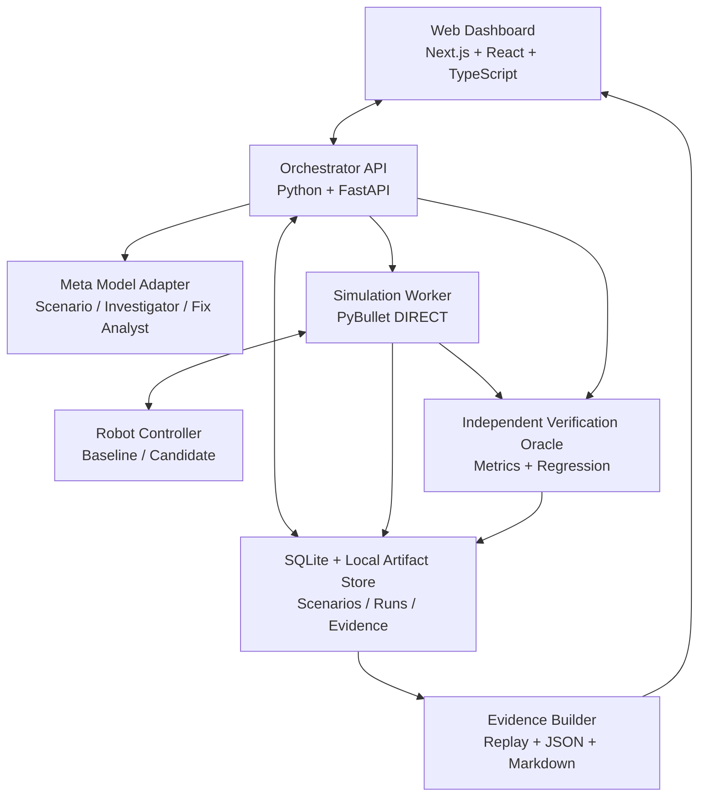

# RoboWitness — Software-Only MVP Mimarisi

> **Sürüm:** 1.0 · **Durum:** Hackathon MVP planı · **Dil:** Türkçe  
> **Ana ilke:** Tek robot türü, dört günde çalışan uçtan uca MVP; sonrasında genişletme ve cilalama.  
> **Ürün vaadi:** *RoboWitness doesn't just find robotic failures. It generates reproducible evidence that proposed fixes actually work.*

---

## 1. Vizyon ve hedef

**RoboWitness**, otonom robotların davranışlarını tamamen yazılım içinde sınayan, zorlayıcı test senaryoları üreten, hataları araştıran, düzeltme önerilerini **bağımsız olarak tekrar test eden** ve yeniden üretilebilir teknik kanıtlar hazırlayan bir doğrulama platformudur.

### Temel prensipler

1. **%100 yazılım:** Fiziksel robot, sensör, kamera, elektronik donanım veya gerçek dünya bağlantısı yok.
2. **MVP'de tek robot:** Sanal depoda hareket eden **diferansiyel sürüşlü tekerlekli mobil robot**.
3. **Fizik tabanlı sanal test:** Hareket, çarpışma ve sanal sensör davranışı simüle edilir.
4. **AI hakem değil, yardımcı:** AI senaryo ve hipotez önerir; **PASS / FAIL / INCONCLUSIVE** kararını objektif, bağımsız kurallar verir.
5. **Hata → neden → düzeltme → doğrulama → kanıt:** Ekranda tek bir uçtan uca akış çalışır.
6. **Dört günlük katı kapsam:** Temel akış çalışmadan yeni robot, gelişmiş 3D dünya, çoklu ajan, bulut mimarisi veya büyük veri sistemi eklenmez.

### MVP dışı

Gerçek robot entegrasyonu, ROS 2 zorunluluğu, lidar/SLAM'ın gerçeğe yakın tüm ayrıntıları, insansı robotlar, robot kolları, çoklu robot koordinasyonu, fiziksel dünya için güvenlik sertifikası, üretim ölçeğinde dağıtık servisler.

---

## 2. Demo senaryosu: «AI düzeltmesini bile sorgulayan sistem»

1. Robot depoda başlangıçtan hedefe gider.
2. Test üretici, yoluna çıkan hareketli engel ve **sanal sensör gecikmesi** gibi zorlayıcı koşullar önerir.
3. İlk kontrol politikası çarpışır veya güvenlik mesafesini ihlal eder.
4. RoboWitness hata anını, simülasyon tohumunu (*seed*), durumu ve telemetriyi kaydeder.
5. Meta AI olası kök nedeni açıklar ve **izin verilen kontrol parametrelerinden** bir değişiklik önerir.
6. Aynı başlangıç koşullarında eski ve yeni politikalar karşılaştırılır.
7. Bağımsız doğrulayıcı yeni / daha önce görülmemiş senaryoları ve regresyon testlerini çalıştırır.
8. Düzeltme ilk testi geçse bile başka gereksinimi (ör. varış süresi) bozuyorsa **REJECTED** kararı verilir.
9. Dashboard, **önce/sonra replay + ölçümler + doğrulama kararı + kanıt paketi** gösterir.

> En etkileyici gösterim, AI'nın sunduğu düzeltmenin gerektiğinde bağımsız doğrulayıcı tarafından **reddedilmesidir**. Amaç yapay biçimde tüm testleri başarılı göstermek değildir.

---

## 3. Üst düzey mimari



### Mimari kararı: Basit monorepo, minimum altyapı

- **Frontend:** Next.js, React, TypeScript, Canvas veya hafif 2D katman; senaryo ekranı, simülasyon görselleştirmesi, olay akışı, karşılaştırmalı replay ve rapor.
- **Backend:** Python, FastAPI, Pydantic. İstekleri doğrular, test yaşam döngüsünü yönetir ve sonuçları sunar.
- **Simülasyon:** PyBullet `DIRECT` modunda arka planda; tek diferansiyel sürüşlü robot, depo, statik/hareketli engeller, sınırlı sanal mesafe algılama, çarpışma kontrolleri.
- **Kontrol politikası:** Başlangıçta basit, deterministik *baseline*; düzeltme, izin verilen küçük parametre alanından seçilen *candidate*.
- **Meta AI:** Yapılandırılmış senaryo önerisi, açıklama/hipotez, sınırlı düzeltme önerisi. Model kimliği ve endpoint **yapılandırılabilir**; hackathon erişiminde kullanılabilir model seçilir.
- **İş yürütme:** Tek ayrı worker süreci ve disk üzerinde iş durumları. İlk dört günde Redis/Celery/Kubernetes zorunlu değil.
- **Kalıcılık:** SQLite + dosya tabanlı, versiyonlanmış JSON/JSONL rapor ve replay kayıtları.
- **İleride:** İş hacmi gerektirirse PostgreSQL, Redis kuyruk ve nesne depolama eklenebilir; MVP gereksinimi değildir.

### Güven sınırları

- AI tarafından üretilen **rastgele Python kodu çalıştırılmaz**. AI yalnızca şemaya uyan veri veya beyaz listeyle sınırlandırılmış parametre önerir.
- Robotun controller'ı dünyanın gerçek durumuna (*ground truth*) erişemez; yalnızca sanal sensör okumalarını alır.
- Doğrulayıcı, controller ve AI'dan bağımsız telemetri/ground truth okur.
- Oracle eşikleri test **başlamadan önce** belirlenir; AI test sonrasında eşikleri değiştirerek başarı üretemez.
- Web UI'nın animasyonu doğruluğun kaynağı değildir; kayıtlı simülasyon olaylarından üretilen görselleştirmedir.

---

## 4. Çekirdek bileşenler

### A. Scenario Engine

**Girdi:** Test hedefi, geçerli dünya kısıtları ve senaryo şeması.  
**Çıktı:** Pydantic ile doğrulanmış `ScenarioSpec`.

Parametre alanları: robot hızı, başlangıç/hedef, statik/hareketli engel, engel hızı/yönü, sürtünme (destekleniyorsa), sensör gecikmesi, ölçüm gürültüsü, rastgelelik tohumu, maksimum süre. Sınır dışı/güvenilmez parametreler reddedilir. Başlangıçta bir **elle yazılmış referans senaryo** daima mevcuttur; AI erişimi olmadan demo çalışır.

### B. Simulation Engine

Sabit zaman adımıyla (*fixed timestep*) çalışır. Senaryoyu kurar, robot kontrol politikasını besler, her adımda sensör okumasını üretir, kontrol komutunu uygular, telemetriyi kaydeder. Arka planda (`DIRECT`) yürütülür; frontend replay verisini kullanır.

### C. Failure Detector / Oracle

Kural tabanlı ve AI'dan bağımsızdır. Örnek MVP kuralları:

| Gereksinim | Başlangıç değeri | Doğrulama yöntemi |
|---|---:|---|
| Çarpışmasız çalışma | 0 çarpışma | Motor olayları + bağımsız konum/geometri kontrolü |
| Minimum açıklık | ≥ 0,25 m | Ground-truth geometrisi |
| Hedefe ulaşma | Hedef bölgesine girme | Son pozisyon / hedef yarıçapı |
| Görev süresi | ≤ 30 sn | Simüle edilen süre |
| Uzun süre takılmama | < 3 sn | Konum ilerlemesi ve hareket geçmişi |
| Regresyon | Kritik testlerde yeni ihlal yok | Sabit regresyon paketi |

> Bunlar yalnızca **ilk demo için örnek eşiklerdir**. Sanal robotun boyutları, hızları ve görevine göre kalibre edilmelidir. Tek bir senaryonun geçmesi gerçek dünya güvenliği kanıtı değildir.

Kararlar:
- `PASS`: Değerlendirilebilir tüm ilgili şartlar karşılandı.
- `FAIL`: En az bir bağlayıcı gereksinim ihlali var.
- `INCONCLUSIVE`: Telemetri eksik, deney geçersiz, test yarım kaldı veya ölçüm yeterli değil.

### D. Failure Investigator

Hata zaman damgası, controller çıkışları, sanal sensör gecikmesi/ölçümleri, engel hareketi ve kural ihlali gibi **yapılandırılmış olayları** Meta AI'ya verir. Model olası nedenleri ve sınanabilir karşıolgusal deneyleri önerir. **AI hipotezi kök neden kanıtı sayılmaz.** Mümkünse tek değişkenli deneyle hipotez desteklenir veya reddedilir.

### E. Fix & Verification Engine

İlk MVP'de AI'nın kodu serbestçe yeniden yazmasına izin verilmez. Öneriler *beyaz liste* parametrelerini değiştirir: ör. `max_speed`, `safe_distance`, `reaction_margin`, `brake_gain` veya `obstacle_prediction_horizon`.

Doğrulama kapıları:
1. **Reproduction:** Temel senaryoda hata tekrar oluşmalı.
2. **Paired replay:** Eski ve aday politika **aynı seed / aynı başlangıç koşulları** altında test edilmeli.
3. **Holdout:** Düzeltme seçiminde kullanılmamış en az **20 test senaryosu** (MVP hedefi).
4. **Regression:** Daha önce geçen kritik vakalar bozulmamalı.
5. **Evidence:** Karar gerekçesi, parametre farkı, log ve ortam sürümü kaydedilmeli.

`VERIFIED_IN_SIMULATION` ancak ilgili kapılar geçildiğinde üretilebilir. Bu etiket **gerçek robotun sahada güvenli olduğu** anlamına gelmez.

### F. Evidence Engine

Her deneme için:

- `scenario.json`: Parametreler, kısıtlar, seed.
- `manifest.json`: Simülatör sürümü, yapılandırma, controller sürümü/hash, zaman adımı, test kimliği.
- `telemetry.jsonl`: Zaman, robot/engel pozisyonları, sensör, kontrol komutu, hız ve olaylar.
- `metrics.json`: Kurallar, ölçümler, sonuç ve gerekçe.
- `investigation.json`: AI hipotezleri ve doğrulayan/çürüten deneyler.
- `comparison.json`: Baseline–candidate farkı, paired ve holdout sonuçları.
- `report.md`: İnsan tarafından okunabilir teknik rapor.
- `sha256` özetleri: Dosyaların bütünlüğünü doğrulama.

**Tekrarlanabilirlik ilkesi:** Seed + senaryo + kod/bağımlılık sürümleri sabitlenir. Fizik motorlarında cihaz/sürüm farklılıklarından kaynaklanan küçük sayısal ayrışmalar olabilir; hiçbir ortamda mutlak bit düzeyinde eşitlik vaat edilmez.

---

## 5. Test veri sözleşmesi

Örnek `ScenarioSpec`:

```json
{
  "id": "RW-001",
  "kind": "dynamic_obstacle",
  "seed": 1842,
  "world": {
    "type": "warehouse",
    "duration_limit_s": 30,
    "fixed_timestep_s": 0.016666667
  },
  "robot": {
    "kind": "differential_drive",
    "initial_speed_mps": 1.2,
    "sensor_latency_ms": 450
  },
  "obstacles": [
    {"id": "O1", "kind": "moving", "speed_mps": 0.7}
  ],
  "oracle": {
    "collision_free": true,
    "min_clearance_m": 0.25,
    "must_reach_goal": true,
    "max_duration_s": 30
  }
}
```

Bu bir **tasarım sözleşmesi örneğidir**; alan adları gerçek Pydantic modelleri yazılırken tek kaynaktan türetilir. Konumlar, yol geometrisi ve engel rotaları dahil eksik alanlar ilk uygulamada açıkça tanımlanmalıdır.

---

## 6. API taslağı

| Method | Endpoint | İşlev |
|---|---|---|
| `POST` | `/api/scenarios/generate` | Meta AI'dan yapılandırılmış senaryo iste |
| `POST` | `/api/runs` | Senaryo + politika ile simülasyon başlat |
| `GET` | `/api/runs/{run_id}` | Durum, metrikler, karar |
| `GET` | `/api/runs/{run_id}/telemetry` | Replay için zaman serisi |
| `POST` | `/api/failures/{failure_id}/investigate` | Hipotez/deney önerilerini üret |
| `POST` | `/api/fixes/verify` | Aday parametrelerle paired, holdout ve regresyon testleri |
| `GET` | `/api/evidence/{verification_id}` | Kanıt manifesti ve raporu |

İşler `queued → running → completed | failed | inconclusive` durumlarını taşır. MVP'de `GET` ile polling yeterli; WebSocket/SSE sonradan eklenebilir. Her iş için zaman aşımı ve iptal mekanizması gereklidir.

---

## 7. Klasör yapısı (önerilen)

```text
robowitness/
├── apps/
│   └── web/                          # Next.js Dashboard
├── backend/
│   ├── app.py                        # FastAPI
│   ├── api/                          # REST routes + validation
│   ├── schemas/                      # Pydantic contracts
│   ├── ai/
│   │   ├── meta_adapter.py           # model/endpoint configurable
│   │   ├── scenario_generator.py
│   │   └── failure_investigator.py
│   ├── simulation/
│   │   ├── world.py                  # PyBullet DIRECT
│   │   ├── robot.py
│   │   ├── sensors.py
│   │   └── runner.py
│   ├── policies/
│   │   ├── baseline.py
│   │   └── configurable.py
│   ├── verification/
│   │   ├── oracle.py
│   │   ├── experiments.py
│   │   └── regression.py
│   ├── evidence/
│   │   ├── recorder.py
│   │   └── reporter.py
│   └── jobs/                         # 1 worker + SQLite job status
├── scenarios/
│   ├── reference/                    # AI olmadan çalışan temel testler
│   └── regression/
├── tests/
├── artifacts/                        # gitignored run output
├── README.md
├── .env.example
└── docker-compose.yml               # İsteğe bağlı yerel çalıştırma
```

---

## 8. Dashboard UX — tek ekranda ikna edici demo

**Ana akış:** `Generate Scenario` → `Run Baseline` → `Investigate Failure` → `Apply Candidate Fix` → `Verify Fix` → `View Evidence`.

MVP ekran alanları:

1. **Scenario panel:** Senaryo parametreleri, seed, AI açıklaması.
2. **Simulation viewport:** Tepeden 2D depo haritası, robot/engeller, rota, çarpışma işareti.
3. **Timeline:** Adımlar ve hata anı, replay kontrolleri.
4. **Comparison:** Baseline / candidate metrikleri ve iki replay'in karşılaştırması.
5. **Decision:** `PASS`, `FAIL`, `INCONCLUSIVE`, `VERIFIED_IN_SIMULATION` veya `REJECTED` durumları.
6. **Evidence:** Teknik rapor, seed, sürüm bilgisi, JSON/JSONL çıktıları.

Kritik UX ilkesi: Rapor sadece AI tarafından yazılmış bir açıklama değil, doğrudan ölçülmüş olaylara bağlanmalıdır.

---

## 9. Dört günlük MVP uygulama planı

### Gün 1 — Deterministik çekirdek

- [ ] Monorepo, FastAPI, frontend ve çalıştırma yönergeleri.
- [ ] PyBullet'da tek sanal depo + tek diferansiyel sürüşlü robot.
- [ ] Baseline kontrol politikası, sabit zaman adımı, telemetri.
- [ ] En az bir **elle hazırlanmış, tekrar üretilebilir başarısız test**.
- [ ] İlk oracle: collision, goal, timeout.

**Gün sonu kabulü:** `seed` ile aynı test çalıştırılabiliyor; hata backend tarafından tespit edilip JSON kaydediliyor.

### Gün 2 — Meta AI + gerçek test üretimi

- [ ] Meta model adaptörü, `.env` ile kimlik/model yapılandırması.
- [ ] Structured output + Pydantic validasyon + hatalı çıktıya kontrollü retry.
- [ ] Senaryo üretimi ve simülasyon API entegrasyonu.
- [ ] 2D dashboard ve replay.

**Gün sonu kabulü:** AI tarafından üretilen **geçerli** senaryo çalışıyor; test olayları dashboard'da izleniyor.

### Gün 3 — Investigation + bağımsız doğrulama

- [ ] Hata loglarından AI hipotezleri.
- [ ] Parametre tabanlı aday düzeltme.
- [ ] Baseline / candidate eşleştirilmiş testler.
- [ ] Holdout ve regresyon testi; bağımsız oracle.
- [ ] `INCONCLUSIVE` ve `REJECTED` kararları.

**Gün sonu kabulü:** AI düzeltmesi hem kabul **hem de reddedilebilir**; karar objektif kurallara dayanıyor.

### Gün 4 — Kanıt, demo ve stabilizasyon

- [ ] Manifest, hash'ler, rapor ve dışa aktarılabilir kanıt paketi.
- [ ] Karşılaştırmalı replay, açıklayıcı durum kartları.
- [ ] En az 1 başarılı ve 1 reddedilmiş düzeltme demo akışı.
- [ ] Baştan sona test, hata toleransı, kurulum, README ve kısa demo kaydı.

**Gün sonu kabulü:** Sıfırdan başlatılmış sistemde tek bir operatör, demo boyunca senaryo → simülasyon → analiz → düzeltme → bağımsız test → kanıt sürecini tamamlayabiliyor.

### Zaman daralırsa vazgeçme sırası

1. Gelişmiş animasyon ve UI cilasını azalt.
2. Hareketli engel çeşitliliğini ve fizik parametrelerini kısıtla.
3. Holdout sayısını geçici olarak daha küçük tut **ama raporda gerçek sayıyı göster**.
4. Serbest AI analizini basitleştir; manuel seçilebilir hipotez/aday düzeltme sun.
5. **Asla çıkarma:** Bağımsız oracle, yeniden üretilebilir başarısız test, eski/yeni karşılaştırması, gerçek sonuçları gösteren kanıt.

---

## 10. Başarı kriterleri / Definition of Done

- [ ] Tek mobil robot için en az bir tutarlı ortam ve temel kontrol politikası çalışıyor.
- [ ] AI olmadan bir referans hata tekrarlanabiliyor.
- [ ] Meta AI en az bir şemaya uygun yeni senaryo üretebiliyor.
- [ ] Hata kural tabanlı tespit edilip nedeni deneysel olarak araştırılabiliyor.
- [ ] Sınırlandırılmış düzeltme önerisi uygulanıp aynı koşullarda yeniden denenebiliyor.
- [ ] Bağımsız oracle holdout ve regresyon sonuçlarına göre düzeltmeyi kabul veya reddedebiliyor.
- [ ] Dashboard'da olay, zaman çizgisi, eski/yeni karşılaştırması ve karar görüntüleniyor.
- [ ] Tekrar üretme için `seed`, politika/ortam sürümü ve telemetri raporlanıyor.
- [ ] README'deki adımlarla yeni bir geliştirme ortamında sistem başlatılabiliyor.

---

## 11. Maliyet ve çalışma modu

- **Meta AI API:** Hackathon için verilen **150 USD kredi**; senaryo üretimi, kök neden yorumu ve düzeltme önerisine odaklan.
- **Yerel simülasyon:** Normal şartlarda yerel CPU üzerinde; AI kredisi simülasyon çalıştırmak için kullanılmaz.
- **Maliyet koruması:** Token/istek sınırı, koşu başına bütçe, sonuç önbelleği, başarısız AI isteğine sınırlı retry ve toplam harcama takibi.
- **Fallback:** Meta API erişimi kesilirse en az bir referans senaryo + kaydedilmiş örnek analiz üzerinden gerçek simülasyon ve bağımsız doğrulama çalışmaya devam eder. Önceden kaydedilmiş AI çıktısı canlı üretilmiş gibi gösterilmez.
- Kullanılabilir Meta modeli, kota ve fiyatları uygulama başlangıcında **gerçek hackathon hesap erişimi ve güncel dokümantasyon** üzerinden doğrulanır; mimari tek model adına sabitlenmez.

---

## 12. Riskler ve tedbirler

| Risk | Tedbir |
|---|---|
| Dört günde fazla kapsam | Tek robot, tek depo, tek güçlü demo; erteleme listesi |
| AI hatalı veya geçersiz senaryo üretir | Sıkı JSON şeması, sınırlar, retry, deterministik fallback |
| AI kendi çözümünü başarılı ilan eder | Kararları yalnızca bağımsız oracle verir |
| İlk test geçer, başka testler bozulur | Holdout + regresyon testleri, `REJECTED` |
| Simülasyon deterministik değildir | Seed + sürüm + sabit timestep, toleranslı karşılaştırmalar |
| Simülatör ve oracle aynı hatayı paylaşır | Farklı geometri hesabı, çapraz kontrol ve oracle birim testleri |
| Sensör ile gerçek durum yanlışlıkla karışır | Controller erişim sınırı; ground truth ayrı saklanır |
| API kesilir veya kredi biter | Yerel referans senaryo ve offline demo akışı |
| Büyük/belirsiz güvenlik iddiaları | Sonuçları yalnızca simülasyon kapsamıyla sınırla |

---

## 13. MVP sonrası genişleme (4 günün DIŞINDA)

**Önce cilalama:** Dashboard görselliği, iki senkron replay, hızlandırılmış video, anlatımı güçlü rapor, sürtünmesiz onboarding, test altyapısı, ölçüm kalibrasyonu.

**Sonra platformlaştırma:** PostgreSQL + Redis/Celery, daha kapsamlı senaryo aileleri, istatistiksel doğrulama, otomatik karşıolgusal test üretimi, farklı policy sürümlerini karşılaştırma, sürüm kıyaslama, CI entegrasyonu, yetkilendirme ve gerçek robot arabirimleri (yalnızca kapsam genişlediğinde).

**Yeni robot türleri yalnızca mevcut tek robotun uçtan uca testi ve kanıt üretimi sağlamlaştıktan sonra** değerlendirilecek.

---

## 14. Değişmez ürün ilkesi

> **“The AI proposes. The simulator executes. The independent oracle decides. The evidence explains.”**

RoboWitness'ın temel farkı test sayısı veya 3D grafik kalitesi değildir; **önerilen düzeltmelerin gerçekten işe yarayıp yaramadığını, açık kurallarla ve tekrar üretilebilir kanıtla göstermesidir.**
